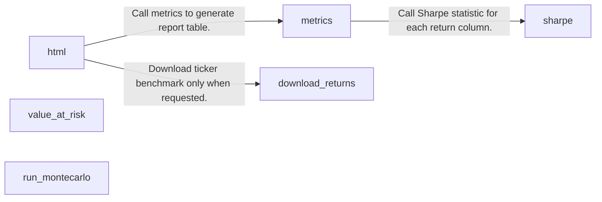
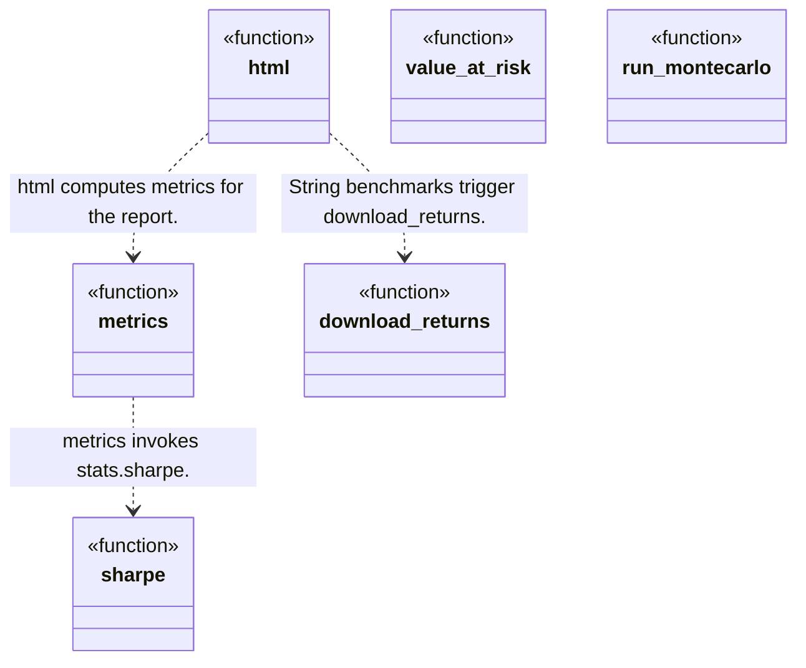
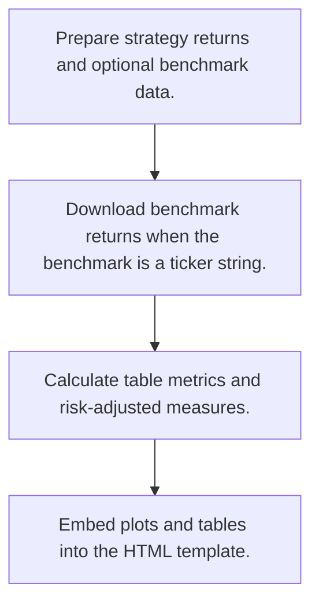
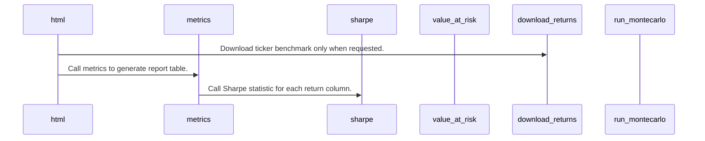

# QuantStats: workflow, design and architecture

Updated: **2026-10-13**
Reviewed Git hash: `2a4df37903149c933dc8495c01c42e87d9f46ba9`
Branch: `feature/ayu_develop`
Source diff SHA256: `e3b0c44298fc1c149afbf4c8996fb92427ae41e4649b934ca495991b7852b855`
Scope: **Performance analytics library** / Maintenance: **active**
Languages: Python

[HTML edition](ayu-develop.html) / [Development](development.md) / [Historical validation](validation.md) / [Full system comparison](../../docs/index.html)

## Purpose and scope

Analyze supplied return series and generate benchmark comparisons, risk metrics and HTML reports.

## Features and support boundaries

Native = implemented here. Integration = supplied through a named host/API. Limited = material restriction. Not provided = evidenced scope exclusion. Unverified = support/absence not established. Not applicable = outside this artifact type.

| Capability | Status | Implementation and limits | Source |
|---|---|---|---|
| Backtesting | Not applicable | The inspected API analyzes already-produced returns rather than executing a trading strategy. | [html](../src/quantstats/reports.py) ([L206](https://github.com/alexcwyu/quantstats/blob/2a4df37903149c933dc8495c01c42e87d9f46ba9/src/quantstats/reports.py#L206)) / [metrics](../src/quantstats/reports.py) ([L1193](https://github.com/alexcwyu/quantstats/blob/2a4df37903149c933dc8495c01c42e87d9f46ba9/src/quantstats/reports.py#L1193)) |
| Live execution | Not applicable | Return analysis and report generation do not provide broker execution. | [html](../src/quantstats/reports.py) ([L206](https://github.com/alexcwyu/quantstats/blob/2a4df37903149c933dc8495c01c42e87d9f46ba9/src/quantstats/reports.py#L206)) / [metrics](../src/quantstats/reports.py) ([L1193](https://github.com/alexcwyu/quantstats/blob/2a4df37903149c933dc8495c01c42e87d9f46ba9/src/quantstats/reports.py#L1193)) |
| Paper trading | Unverified | The inspected source does not establish this capability. This is not a claim of absence. | Not applicable to this repository scope. |
| Event driven | Unverified | The inspected source does not establish this capability. This is not a claim of absence. | Not applicable to this repository scope. |
| Vectorized | Native | Statistical calculations use pandas/numpy return series. | [sharpe](../src/quantstats/stats.py) ([L938](https://github.com/alexcwyu/quantstats/blob/2a4df37903149c933dc8495c01c42e87d9f46ba9/src/quantstats/stats.py#L938)) / [value_at_risk](../src/quantstats/stats.py) ([L2014](https://github.com/alexcwyu/quantstats/blob/2a4df37903149c933dc8495c01c42e87d9f46ba9/src/quantstats/stats.py#L2014)) |
| Order management | Not applicable | Input is a return series, not order lifecycle messages. | [metrics](../src/quantstats/reports.py) ([L1193](https://github.com/alexcwyu/quantstats/blob/2a4df37903149c933dc8495c01c42e87d9f46ba9/src/quantstats/reports.py#L1193)) |
| Order types | Not applicable | Report metrics have no simulated or live order type semantics. | [metrics](../src/quantstats/reports.py) ([L1193](https://github.com/alexcwyu/quantstats/blob/2a4df37903149c933dc8495c01c42e87d9f46ba9/src/quantstats/reports.py#L1193)) |
| Multi venue | Unverified | The inspected source does not establish this capability. This is not a claim of absence. | Not applicable to this repository scope. |
| Crypto | Unverified | The inspected source does not establish this capability. This is not a claim of absence. | Not applicable to this repository scope. |
| Equities | Integration | Yahoo ticker history can supply equity returns. Market-specific execution semantics are outside this library. | [download_returns](../src/quantstats/utils.py) ([L758](https://github.com/alexcwyu/quantstats/blob/2a4df37903149c933dc8495c01c42e87d9f46ba9/src/quantstats/utils.py#L758)) |
| Futures | Unverified | The inspected source does not establish this capability. This is not a claim of absence. | Not applicable to this repository scope. |
| Options | Unverified | The inspected source does not establish this capability. This is not a claim of absence. | Not applicable to this repository scope. |
| Forex | Unverified | The inspected source does not establish this capability. This is not a claim of absence. | Not applicable to this repository scope. |
| Strategy api | Not applicable | The API accepts strategy returns rather than strategy callbacks. | [metrics](../src/quantstats/reports.py) ([L1193](https://github.com/alexcwyu/quantstats/blob/2a4df37903149c933dc8495c01c42e87d9f46ba9/src/quantstats/reports.py#L1193)) |
| Optimization | Unverified | The inspected source does not establish this capability. This is not a claim of absence. | Not applicable to this repository scope. |
| Machine learning | Unverified | The inspected source does not establish this capability. This is not a claim of absence. | Not applicable to this repository scope. |
| Reinforcement learning | Unverified | The inspected source does not establish this capability. This is not a claim of absence. | Not applicable to this repository scope. |
| Portfolio | Limited | Multiple return columns can represent strategies/portfolios. Portfolio construction and holdings are outside the inspected API. | [metrics](../src/quantstats/reports.py) ([L1193](https://github.com/alexcwyu/quantstats/blob/2a4df37903149c933dc8495c01c42e87d9f46ba9/src/quantstats/reports.py#L1193)) |
| Risk management | Limited | VaR and other risk statistics are analytical measures, not enforced trading limits. | [value_at_risk](../src/quantstats/stats.py) ([L2014](https://github.com/alexcwyu/quantstats/blob/2a4df37903149c933dc8495c01c42e87d9f46ba9/src/quantstats/stats.py#L2014)) |
| Performance analytics | Native | Sharpe, reports, benchmark comparisons and Monte Carlo paths. | [html](../src/quantstats/reports.py) ([L206](https://github.com/alexcwyu/quantstats/blob/2a4df37903149c933dc8495c01c42e87d9f46ba9/src/quantstats/reports.py#L206)) / [metrics](../src/quantstats/reports.py) ([L1193](https://github.com/alexcwyu/quantstats/blob/2a4df37903149c933dc8495c01c42e87d9f46ba9/src/quantstats/reports.py#L1193)) / [sharpe](../src/quantstats/stats.py) ([L938](https://github.com/alexcwyu/quantstats/blob/2a4df37903149c933dc8495c01c42e87d9f46ba9/src/quantstats/stats.py#L938)) / [run_montecarlo](../src/quantstats/_montecarlo.py) ([L218](https://github.com/alexcwyu/quantstats/blob/2a4df37903149c933dc8495c01c42e87d9f46ba9/src/quantstats/_montecarlo.py#L218)) |
| Historical data | Integration | Yahoo Finance Close-to-return downloader. | [download_returns](../src/quantstats/utils.py) ([L758](https://github.com/alexcwyu/quantstats/blob/2a4df37903149c933dc8495c01c42e87d9f46ba9/src/quantstats/utils.py#L758)) |
| Streaming data | Unverified | The inspected source does not establish this capability. This is not a claim of absence. | Not applicable to this repository scope. |
| Persistence | Unverified | The inspected source does not establish this capability. This is not a claim of absence. | Not applicable to this repository scope. |
| Data pipeline | Unverified | The inspected source does not establish this capability. This is not a claim of absence. | Not applicable to this repository scope. |
| Web ui | Limited | Exports a static HTML report with plots, not a hosted trading interface. | [html](../src/quantstats/reports.py) ([L206](https://github.com/alexcwyu/quantstats/blob/2a4df37903149c933dc8495c01c42e87d9f46ba9/src/quantstats/reports.py#L206)) |
| Cli | Unverified | The inspected source does not establish this capability. This is not a claim of absence. | Not applicable to this repository scope. |
| Monitoring | Unverified | The inspected source does not establish this capability. This is not a claim of absence. | Not applicable to this repository scope. |
| Extension api | Native | Report template path and user-supplied return/benchmark inputs. | [html](../src/quantstats/reports.py) ([L206](https://github.com/alexcwyu/quantstats/blob/2a4df37903149c933dc8495c01c42e87d9f46ba9/src/quantstats/reports.py#L206)) |
| Native acceleration | Unverified | The inspected source does not establish this capability. This is not a claim of absence. | Not applicable to this repository scope. |
| Distributed execution | Unverified | The inspected source does not establish this capability. This is not a claim of absence. | Not applicable to this repository scope. |

## System components

| Component | Responsibility | Source |
|---|---|---|
| html | HTML report generation. | [html](../src/quantstats/reports.py) ([L206](https://github.com/alexcwyu/quantstats/blob/2a4df37903149c933dc8495c01c42e87d9f46ba9/src/quantstats/reports.py#L206)) |
| metrics | Tabular report metrics. | [metrics](../src/quantstats/reports.py) ([L1193](https://github.com/alexcwyu/quantstats/blob/2a4df37903149c933dc8495c01c42e87d9f46ba9/src/quantstats/reports.py#L1193)) |
| sharpe | Return risk-adjusted statistics. | [sharpe](../src/quantstats/stats.py) ([L938](https://github.com/alexcwyu/quantstats/blob/2a4df37903149c933dc8495c01c42e87d9f46ba9/src/quantstats/stats.py#L938)) |
| value_at_risk | Parametric downside risk analytics. | [value_at_risk](../src/quantstats/stats.py) ([L2014](https://github.com/alexcwyu/quantstats/blob/2a4df37903149c933dc8495c01c42e87d9f46ba9/src/quantstats/stats.py#L2014)) |
| download_returns | Optional Yahoo Finance data integration. | [download_returns](../src/quantstats/utils.py) ([L758](https://github.com/alexcwyu/quantstats/blob/2a4df37903149c933dc8495c01c42e87d9f46ba9/src/quantstats/utils.py#L758)) |
| run_montecarlo | Return-order Monte Carlo analysis. | [run_montecarlo](../src/quantstats/_montecarlo.py) ([L218](https://github.com/alexcwyu/quantstats/blob/2a4df37903149c933dc8495c01c42e87d9f46ba9/src/quantstats/_montecarlo.py#L218)) |

## Architecture and component boundaries

The component view summarizes inspected responsibility boundaries. Arrows identify the documented API/data dependencies; this is not a deployment-readiness claim.

- Download ticker benchmark only when requested.: [html](../src/quantstats/reports.py) ([L206](https://github.com/alexcwyu/quantstats/blob/2a4df37903149c933dc8495c01c42e87d9f46ba9/src/quantstats/reports.py#L206))
- Call metrics to generate report table.: [html](../src/quantstats/reports.py) ([L206](https://github.com/alexcwyu/quantstats/blob/2a4df37903149c933dc8495c01c42e87d9f46ba9/src/quantstats/reports.py#L206))
- Call Sharpe statistic for each return column.: [metrics](../src/quantstats/reports.py) ([L1193](https://github.com/alexcwyu/quantstats/blob/2a4df37903149c933dc8495c01c42e87d9f46ba9/src/quantstats/reports.py#L1193))

## Design decisions

| Decision | Rationale | Tradeoff | Evidence |
|---|---|---|---|
| Use functions operating on supplied return series. | Analytics can be applied to results from different trading engines. | Metric validity depends on return preparation, calendar and annualization assumptions. | [metrics](../src/quantstats/reports.py) ([L1193](https://github.com/alexcwyu/quantstats/blob/2a4df37903149c933dc8495c01c42e87d9f46ba9/src/quantstats/reports.py#L1193)) / [sharpe](../src/quantstats/stats.py) ([L938](https://github.com/alexcwyu/quantstats/blob/2a4df37903149c933dc8495c01c42e87d9f46ba9/src/quantstats/stats.py#L938)) |
| Monte Carlo permutes realized historical returns. | Examines path-order outcomes while retaining the sample values. | Permutation does not model a new market-generating process. | [run_montecarlo](../src/quantstats/_montecarlo.py) ([L218](https://github.com/alexcwyu/quantstats/blob/2a4df37903149c933dc8495c01c42e87d9f46ba9/src/quantstats/_montecarlo.py#L218)) |

## Class and interface relationships

Each node is a reviewed source symbol. Function/module nodes are explicitly labeled; they do not imply Python classes. Only reviewed relationships are drawn.

- **html** (function): [html](../src/quantstats/reports.py) ([L206](https://github.com/alexcwyu/quantstats/blob/2a4df37903149c933dc8495c01c42e87d9f46ba9/src/quantstats/reports.py#L206))
- **metrics** (function): [metrics](../src/quantstats/reports.py) ([L1193](https://github.com/alexcwyu/quantstats/blob/2a4df37903149c933dc8495c01c42e87d9f46ba9/src/quantstats/reports.py#L1193))
- **sharpe** (function): [sharpe](../src/quantstats/stats.py) ([L938](https://github.com/alexcwyu/quantstats/blob/2a4df37903149c933dc8495c01c42e87d9f46ba9/src/quantstats/stats.py#L938))
- **value_at_risk** (function): [value_at_risk](../src/quantstats/stats.py) ([L2014](https://github.com/alexcwyu/quantstats/blob/2a4df37903149c933dc8495c01c42e87d9f46ba9/src/quantstats/stats.py#L2014))
- **download_returns** (function): [download_returns](../src/quantstats/utils.py) ([L758](https://github.com/alexcwyu/quantstats/blob/2a4df37903149c933dc8495c01c42e87d9f46ba9/src/quantstats/utils.py#L758))
- **run_montecarlo** (function): [run_montecarlo](../src/quantstats/_montecarlo.py) ([L218](https://github.com/alexcwyu/quantstats/blob/2a4df37903149c933dc8495c01c42e87d9f46ba9/src/quantstats/_montecarlo.py#L218))

## Workflow

### Representative source-backed flow

The steps describe the inspected implementation. User configuration and data inputs are external prerequisites.

1. Prepare strategy returns and optional benchmark data.. [html](../src/quantstats/reports.py) ([L206](https://github.com/alexcwyu/quantstats/blob/2a4df37903149c933dc8495c01c42e87d9f46ba9/src/quantstats/reports.py#L206))
2. Download benchmark returns when the benchmark is a ticker string.. [html](../src/quantstats/reports.py) ([L206](https://github.com/alexcwyu/quantstats/blob/2a4df37903149c933dc8495c01c42e87d9f46ba9/src/quantstats/reports.py#L206)) / [download_returns](../src/quantstats/utils.py) ([L758](https://github.com/alexcwyu/quantstats/blob/2a4df37903149c933dc8495c01c42e87d9f46ba9/src/quantstats/utils.py#L758))
3. Calculate table metrics and risk-adjusted measures.. [metrics](../src/quantstats/reports.py) ([L1193](https://github.com/alexcwyu/quantstats/blob/2a4df37903149c933dc8495c01c42e87d9f46ba9/src/quantstats/reports.py#L1193))
4. Embed plots and tables into the HTML template.. [html](../src/quantstats/reports.py) ([L206](https://github.com/alexcwyu/quantstats/blob/2a4df37903149c933dc8495c01c42e87d9f46ba9/src/quantstats/reports.py#L206))

## Sequence

Representative calls and data dependencies

Messages represent inspected calls or explicitly labelled data dependencies. A data dependency is not an asserted direct runtime call.

- Download ticker benchmark only when requested.: [html](../src/quantstats/reports.py) ([L206](https://github.com/alexcwyu/quantstats/blob/2a4df37903149c933dc8495c01c42e87d9f46ba9/src/quantstats/reports.py#L206))
- Call metrics to generate report table.: [html](../src/quantstats/reports.py) ([L206](https://github.com/alexcwyu/quantstats/blob/2a4df37903149c933dc8495c01c42e87d9f46ba9/src/quantstats/reports.py#L206))
- Call Sharpe statistic for each return column.: [metrics](../src/quantstats/reports.py) ([L1193](https://github.com/alexcwyu/quantstats/blob/2a4df37903149c933dc8495c01c42e87d9f46ba9/src/quantstats/reports.py#L1193))

## Strengths and limits

### Strengths

- Reports and standalone statistics share the same return analytics functions. [html](../src/quantstats/reports.py) ([L206](https://github.com/alexcwyu/quantstats/blob/2a4df37903149c933dc8495c01c42e87d9f46ba9/src/quantstats/reports.py#L206)) / [metrics](../src/quantstats/reports.py) ([L1193](https://github.com/alexcwyu/quantstats/blob/2a4df37903149c933dc8495c01c42e87d9f46ba9/src/quantstats/reports.py#L1193)) / [sharpe](../src/quantstats/stats.py) ([L938](https://github.com/alexcwyu/quantstats/blob/2a4df37903149c933dc8495c01c42e87d9f46ba9/src/quantstats/stats.py#L938))

### Limitations

- Normal VaR assumes a parametric distribution and is not a trading risk limiter. [value_at_risk](../src/quantstats/stats.py) ([L2014](https://github.com/alexcwyu/quantstats/blob/2a4df37903149c933dc8495c01c42e87d9f46ba9/src/quantstats/stats.py#L2014))
- The downloader depends on Yahoo Finance availability and adjustments. [download_returns](../src/quantstats/utils.py) ([L758](https://github.com/alexcwyu/quantstats/blob/2a4df37903149c933dc8495c01c42e87d9f46ba9/src/quantstats/utils.py#L758))

## Validation scope

The linked validation and command records preserve actual historical runs and user-authorized exclusions. This source/document review does not rerun application tests, establish live trading readiness or rank benchmark performance. Current data, credential and runtime prerequisites remain material.

[Repository validation](validation.md) / [Executed checks](maintenance/index.md)

## Source map

| Reviewed symbol/path | Inspected responsibility | Actual file SHA256 |
|---|---|---|
| [html](../src/quantstats/reports.py) ([L206](https://github.com/alexcwyu/quantstats/blob/2a4df37903149c933dc8495c01c42e87d9f46ba9/src/quantstats/reports.py#L206)) | Prepares returns and optional benchmark, reads the report template, computes metrics and embeds generated plots. | `254e2541e6b2f3bb03c01c2cfb9728aaaef4892fbabf4efb0687914f373daf51` |
| [metrics](../src/quantstats/reports.py) ([L1193](https://github.com/alexcwyu/quantstats/blob/2a4df37903149c933dc8495c01c42e87d9f46ba9/src/quantstats/reports.py#L1193)) | Builds strategy/benchmark columns and invokes analytics such as Sharpe, drawdown and return measures. | `254e2541e6b2f3bb03c01c2cfb9728aaaef4892fbabf4efb0687914f373daf51` |
| [sharpe](../src/quantstats/stats.py) ([L938](https://github.com/alexcwyu/quantstats/blob/2a4df37903149c933dc8495c01c42e87d9f46ba9/src/quantstats/stats.py#L938)) | Validates input, prepares excess returns, uses sample standard deviation and optional autocorrelation penalty, then annualizes. | `07b3ceeec1a06f90fddb33ec6b089f7f8dbfa2a4cd6b6d6affb7e0acd0f51503` |
| [value_at_risk](../src/quantstats/stats.py) ([L2014](https://github.com/alexcwyu/quantstats/blob/2a4df37903149c933dc8495c01c42e87d9f46ba9/src/quantstats/stats.py#L2014)) | Estimates normal-distribution VaR using prepared return mean and volatility with supplied confidence. | `07b3ceeec1a06f90fddb33ec6b089f7f8dbfa2a4cd6b6d6affb7e0acd0f51503` |
| [download_returns](../src/quantstats/utils.py) ([L758](https://github.com/alexcwyu/quantstats/blob/2a4df37903149c933dc8495c01c42e87d9f46ba9/src/quantstats/utils.py#L758)) | Uses safe_yfinance_download Close prices, computes percentage returns and removes timezone metadata. | `cd1aed9b93033ef349d5965fb046fd05f30d0a307637a2ff6de84b248fa41b4c` |
| [run_montecarlo](../src/quantstats/_montecarlo.py) ([L218](https://github.com/alexcwyu/quantstats/blob/2a4df37903149c933dc8495c01c42e87d9f46ba9/src/quantstats/_montecarlo.py#L218)) | Builds seeded permutations of historical returns, compounds paths and returns a MonteCarloResult. | `321d1ba6f04ceea615d0523b996118365a91e8e95dd27722769d7bd42e6c5edf` |

## Documentation provenance

Review date: 2026-10-13. Full committed source HEAD: `2a4df37903149c933dc8495c01c42e87d9f46ba9`. Template version: 2. 4 source files were independently hashed for this guide.

[Evidence catalog](../../docs/systems-2026-10-13/catalog.json) / [Standard template](../../docs/guidelines/APP_TEMPLATE.md)

- Snapshot provenance: inventory.json full HEAD 2a4df37903149c933dc8495c01c42e87d9f46ba9, branch feature/ayu_develop. Source was inspected in the existing checkout and no repository files were changed.
- Inspected implementation bodies and existing architecture documentation. This is a representative static source audit, not a runtime or live-service validation. Credential exclusions in current validation are policy, not evidence that a live connection succeeds.
- Inspected source files: src/quantstats/reports.py, src/quantstats/stats.py, src/quantstats/utils.py, src/quantstats/_montecarlo.py
