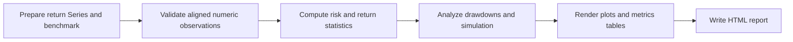
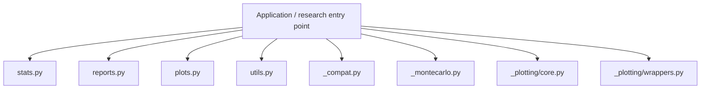
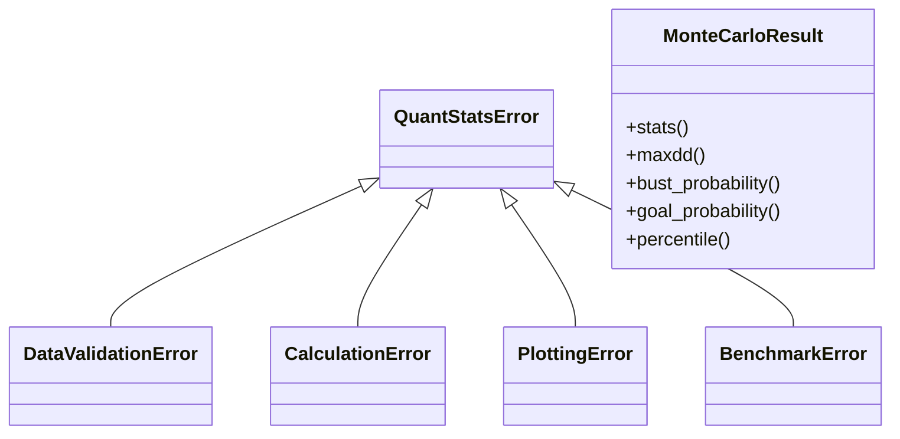
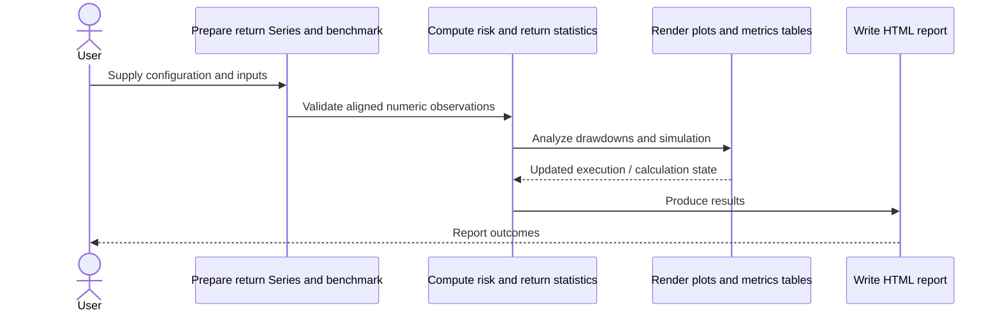
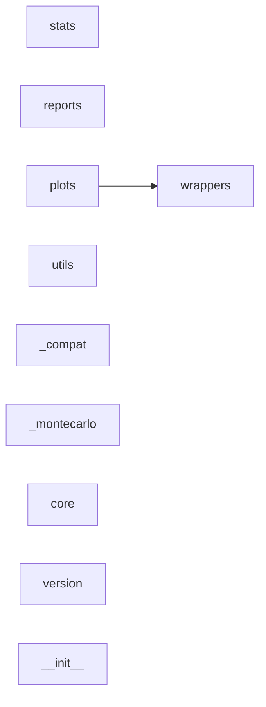
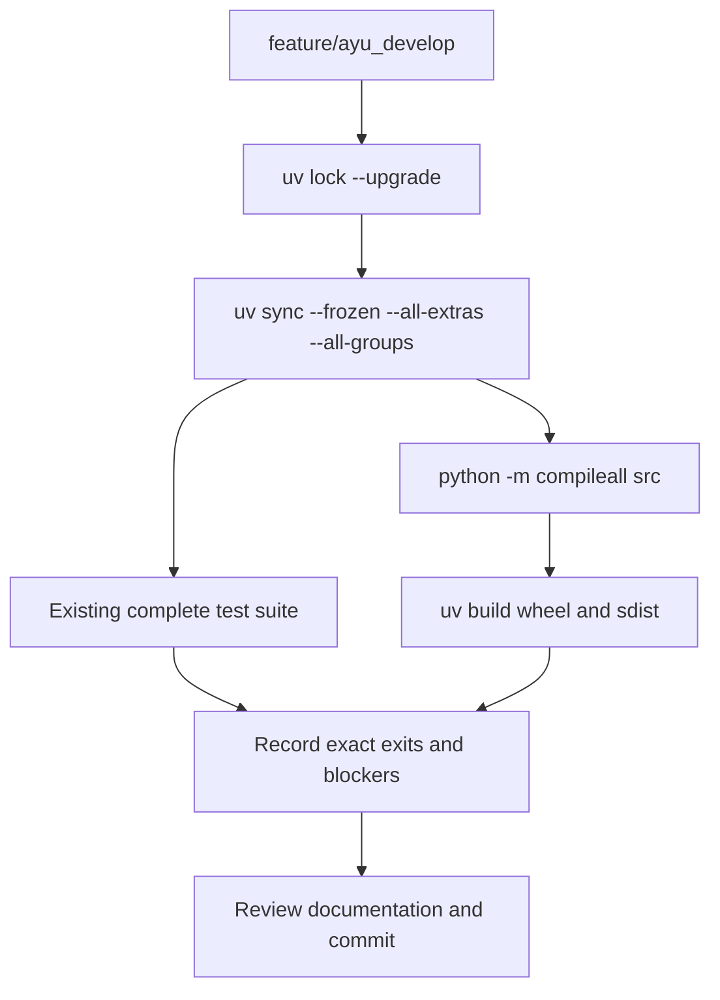

# quantstats: development, architecture and operations

Updated 2026-10-12 on `feature/ayu_develop`; source snapshot `08870d92da02`. This guide follows the source in this checkout and separates available interfaces from verification evidence.

## Purpose and feature boundaries

Portfolio return analytics, benchmark-relative metrics, drawdowns, plotting, Monte Carlo diagnostics and HTML tearsheet generation.

The public API is primarily functional: stats operates on return series, plots wraps lower-level rendering, reports assembles tearsheets and utils prepares/downloads data. extend_pandas attaches functions to pandas objects. Explicit validation and exception types make calculation failures distinct from plot/report failures. Benchmark download tests depend on external Yahoo access unless already mocked upstream.

## Main workflow

The following is the repository-specific logical workflow. Runtime execution details remain in the linked source and the validation record.

1. Prepare return Series and benchmark.
2. Validate aligned numeric observations.
3. Compute risk and return statistics.
4. Analyze drawdowns and simulation.
5. Render plots and metrics tables.
6. Write HTML report.

## Components and ownership

The entry point composes the source modules below; arrows indicate review/navigation boundaries rather than a claim that every module is called in every run.

| Source | Declared classes / functions | Implementation role |
|---|---|---|
| [src/quantstats/stats.py](../src/quantstats/stats.py) | pct_rank, compsum, _paired_observations, comp | Portfolio Statistics Module |
| [src/quantstats/reports.py](../src/quantstats/reports.py) | _get_stats, _get_utils, _get_plots, _rf_scalar | See the public declarations and implementation linked here. |
| [src/quantstats/plots.py](../src/quantstats/plots.py) | Package data / configuration | See the public declarations and implementation linked here. |
| [src/quantstats/utils.py](../src/quantstats/utils.py) | QuantStatsError, DataValidationError, CalculationError, PlottingError, BenchmarkError; validate_input, _generate_cache_key, _clear_cache_if_full, _mtd | See the public declarations and implementation linked here. |
| [src/quantstats/_compat.py](../src/quantstats/_compat.py) | get_frequency_alias, normalize_timezone, safe_resample, safe_concat | Compatibility layer for pandas/numpy versions |
| [src/quantstats/_montecarlo.py](../src/quantstats/_montecarlo.py) | MonteCarloResult; run_montecarlo | Monte Carlo Simulation Module |
| [src/quantstats/_plotting/core.py](../src/quantstats/_plotting/core.py) | _get_stats, _get_colors, plot_returns_bars, plot_timeseries | See the public declarations and implementation linked here. |
| [src/quantstats/_plotting/wrappers.py](../src/quantstats/_plotting/wrappers.py) | _get_stats, _get_utils, to_plotly, snapshot | See the public declarations and implementation linked here. |
| [src/quantstats/version.py](../src/quantstats/version.py) | Package data / configuration | See the public declarations and implementation linked here. |
| [src/quantstats/__init__.py](../src/quantstats/__init__.py) | extend_pandas | See the public declarations and implementation linked here. |
| [src/quantstats/report.html](../src/quantstats/report.html) | Package data / configuration | See the public declarations and implementation linked here. |
| [src/quantstats/_numpy_compat.py](../src/quantstats/_numpy_compat.py) | safe_numpy_operation, safe_array_function, handle_numpy_warnings, safe_percentile | Numpy compatibility layer |
| [src/quantstats/_plotting/__init__.py](../src/quantstats/_plotting/__init__.py) | Package data / configuration | See the public declarations and implementation linked here. |
| [tests/__init__.py](../tests/__init__.py) | Package data / configuration | See the public declarations and implementation linked here. |

## Class design

Methods and inheritance edges are taken from the selected declarations in the actual source. A missing edge means composition or an external base is not asserted here.

## End-to-end interaction

This sequence presents the responsibilities of the main workflow, including the state/result boundary. The linked classes and functions provide the exact method-level contract.

## Source dependency direction

These edges are actual explicit imports between the selected source modules. Dynamic imports, re-exports and third-party internals are omitted.

## Design details and extension points

### `QuantStatsError`

Source: [src/quantstats/utils.py](../src/quantstats/utils.py).

Base exception class for QuantStats

### `DataValidationError`

Source: [src/quantstats/utils.py](../src/quantstats/utils.py).

Raised when input data validation fails

### `CalculationError`

Source: [src/quantstats/utils.py](../src/quantstats/utils.py).

Raised when a calculation fails

### `PlottingError`

Source: [src/quantstats/utils.py](../src/quantstats/utils.py).

Raised when plotting operations fail

### `BenchmarkError`

Source: [src/quantstats/utils.py](../src/quantstats/utils.py).

Raised when benchmark data issues occur

### `MonteCarloResult`

Source: [src/quantstats/_montecarlo.py](../src/quantstats/_montecarlo.py).

Container for Monte Carlo simulation results.

- `stats`: Terminal value statistics across all simulations.
- `maxdd`: Maximum drawdown statistics across all simulations.
- `bust_probability`: Probability of exceeding the bust (drawdown) threshold.
- `goal_probability`: Probability of reaching the goal (return) threshold.
- `percentile`: Get the p-th percentile path across all simulations.

## Repository layout and resources

Installable packages live under `src/`. `pyproject.toml` defines package metadata, build requirements, optional integrations and development dependencies; `uv.lock` records resolved versions, and `.python-version` selects the local interpreter. This layout keeps an accidental checkout import from substituting for the installed wheel. Package resources remain beside their owning modules and are included by the build backend. Existing upstream examples, fixtures, scripts and documentation retain their separate roles.

## Maintenance compatibility and evidence

- The complete supplied suite passes225 cases. The distribution plot uses Matplotlib orientation and explicit box colors rather than Seaborn's deprecated vert argument.
- Matplotlib>=3.10.9,<3.11 avoids Seaborn0.13.2 use of deprecated colormap.set_bad; NumPy>=2.4.6,<2.5 avoids the current Matplotlib date converter's deprecated generic Timedelta unit. These caps are based on actual full-suite failures.

## Development and verification workflow

See [development commands](development.md) and [validation evidence](validation.md) for interpreter selection, dependency exceptions, full-suite results and remaining blockers. No additional test cases were introduced by this maintenance.
